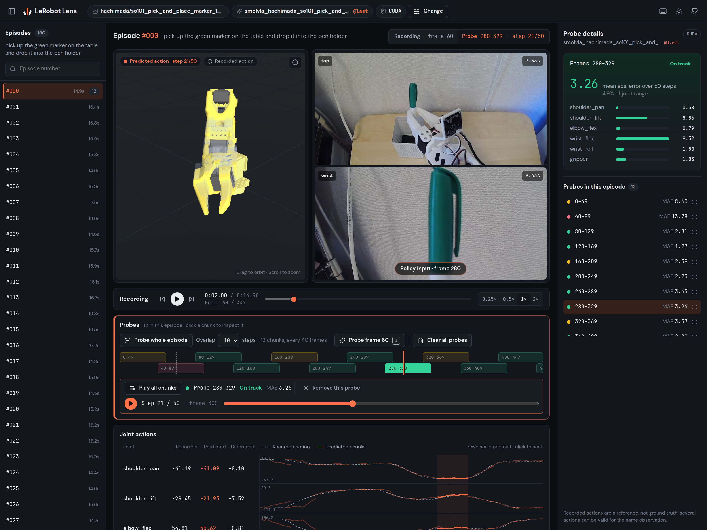

# LeRobot Lens

[](https://github.com/hachimada/lerobot-lens/actions)
[](https://codecov.io/gh/hachimada/lerobot-lens)
[](LICENSE)
[](https://github.com/huggingface/lerobot)

LeRobot Lens visualizes how a policy responds to observations from a LeRobot dataset. It compares the resulting action chunks with recorded actions and can replay the motion using a URDF model.

On training data, it helps verify whether the policy can reproduce the demonstrated behavior. On unseen data, it provides a quick qualitative check of whether the policy's response appears reasonable.



> [!IMPORTANT]
> LeRobot Lens is not a simulator. It does not perform closed-loop rollouts and therefore cannot evaluate grasping, contact, collisions, or task success. It is an offline policy inspection tool for examining responses to recorded observations before testing on a robot or in simulation.

## Features

- Load LeRobot datasets and policies from the Hugging Face Hub or local paths, including local datasets in LeRobot's Lance storage format
- Play recorded episodes
- Infer and replay an action chunk from any frame in a LeRobot dataset
- Compare recorded actions (dashed, full episode) with predicted actions (solid, action chunk) for each joint
- Replay predicted motion using a URDF model

## Requirements

- Python 3.12
- [uv](https://docs.astral.sh/uv/)
- Node.js 20+
- ffmpeg

## Quick start

```bash
make install
```

Build the frontend and start the local application:

```bash
make run
```

Open `http://localhost:8000`, then enter local paths or Hugging Face Hub dataset and policy IDs. FastAPI serves both the UI and API from the same port. The first load from the Hub may require additional time and disk space.

You can also select **Explore with demo data** to try the bundled sample without downloading external artifacts.

## Usage

1. Select a dataset, policy, and device.
2. Optionally provide a URDF, the dataset angle unit, and a Joint Map.
3. Open the workspace and select an episode and frame.
4. Select **Infer action chunk**, then inspect the URDF motion, camera observations, action graph, and chunk replay.

Recorded actions are a reference, not definitive ground truth for policy quality. A difference between recorded and predicted actions does not necessarily indicate failure because multiple actions may be valid for the same observation.

## Joint Map

Use a Joint Map when dataset action names differ from movable joint names in the URDF. Each key is a dataset action name, and its value is the corresponding URDF joint name.

Names that match after removing a `.pos` suffix, such as `shoulder_pan.pos` and `shoulder_pan`, are mapped automatically. Only specify pairs whose names do not match, such as `motor_1.pos` and `shoulder_pan`.

```json
{
  "motor_1.pos": "shoulder_pan",
  "motor_2.pos": "shoulder_lift"
}
```

## Third-party assets

The offline demo includes Episode 0 from [hachimada/so101_pick_place_red_1](https://huggingface.co/datasets/hachimada/so101_pick_place_red_1) and the SO-101 URDF and STL files from [TheRobotStudio/SO-ARM100](https://github.com/TheRobotStudio/SO-ARM100). Both are licensed under the Apache License 2.0.

See [THIRD_PARTY_NOTICES.md](THIRD_PARTY_NOTICES.md) for redistributed materials, modifications, and license texts.
